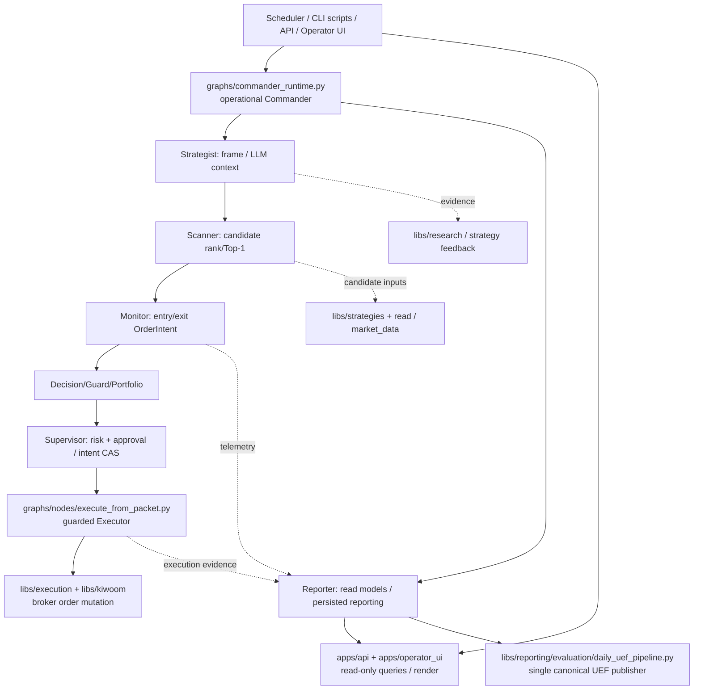
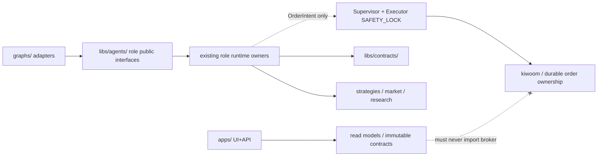

> **PINNED 2026-10-18 DESIGN SNAPSHOT @ 5cb90b39:** Numbers, work states, deleted branch names and G0 phases below describe prior evidence, NOT current implementation tasks. Current state and DOC-FIRST gate: [refactor README](../README.md) + [Issue #20](https://github.com/hbombheart1230-dotcom/agentra/issues/20). The frozen target remains [TREE_V3](TREE_V3_FROZEN.md). Original text follows unchanged.

# Agentra P1.5 — ROOT→LEAF REALITY, unfinished decompositions and cleanup sequence
**As-of:** 2026-10-18; **Code snapshot:** main `2f95bba429636ee15ae9a399cc4ff7c4e6dcd5cb` vs integration `5cb90b39d00cee483be292272b893d8e8a4c6e78` (before Tech Lead documentation commits). GitHub recursive trees both nontruncated. This is **FULL REPO scope**, not `libs/`-only. **DESIGN**, not behavior/runtime approval. For 3,908 individual paths and dispositions see `P15_TREE_ALL_PATHS_PINNED_20261018.txt` and `P15_ALL_FILES_OWNERSHIP_CANDIDATES_20261018.csv`.

## A. Root file/dir baseline

| Root entry | main→integration tracked file situation | Responsibility | What to do before FINAL_FREEZE |
|---|---:|---|---|
| `.github/` | +7 files; **7 total** | hosted CI/required gates | classify workflows, consolidate overlapping CI only after job evidence, preserve Linux/Windows -O normal and protected gates |
| `apps/` | +21 / 1 modified; **235 total** | FastAPI public, React web, Operator UI | separate API adapters/readonly projections, UI facade + LLM effect; keep routes and serialized output stable |
| `config/` | **8** unchanged | defaults and skills configuration | configs central authority, no secrets, no implicit promotion of mocks |
| `data/` | **25** unchanged | versioned specs/eval fixtures | inventory public vs sensitive artifacts, don't relocate live data |
| `deploy/` | **33** unchanged | compose/docker/scheduler launch contracts | no runtime rewrite or unsafe restart; validate referenced `scripts/` paths before retirement |
| `docs/` | +524 / 6 modified; **1,269 total** | plans, historical design, evidence, UI patch notes | canonical landing index vs immutable evidence; archive/index rather than mass delete; old STATUS/GAP explicitly stale |
| `graphs/` | +3 / 5 modified; **45 total** | Commander real operational orchestration + graph adapters/nodes | stop conflating M17 graph stub and real broker; define thin adapter and approved role callable cuts |
| `libs/` | +408 / 76 modified; **1,220 total** | 26 package domain/agent/contract/effect internals | package-wide mapping in `P15_ALL_LIBS_OWNERS_20261018.md`, not just seven agent peers |
| `scripts/` | +203 / 144 modified; **415 total** | entrypoints, CLI, scheduler utilities, diagnostics, research/refactor | map externally scheduled/public wrappers, classify active vs historical; do NOT delete CLI entrypoints by filename |
| `tests/` | +130 / 3 modified; **640 total** | contract, replay, parity, fixtures | consolidation where real duplication proven; keep BASE gates and fixture version; temp-test output is not repository material |
| root files (11) | `AGENTS.md`, `CLAUDE.md` added; `.gitignore`, `conftest.py` modified | rule entry + execution/test controls | resolve conflicting historical work instructions, document current single-source-of-truth and test isolation; examine suspect root artifacts below |

Root tracked singles: `.dockerignore`, `.gitignore`, `AGENTS.md`, `CLAUDE.md`, `README.md`, `_health.json`, `b.jsonl`, `conftest.py`, `pytest.ini`, `requirements.txt`, `sitecustomize.py`. **Cleanup candidates `b.jsonl`, `_health.json` are only flagged for provenance/security/consumer verification, NOT approved for deletion.** Size and content were not inspected for sensitive values here.

**Exact diff** (main→integration source snapshot): main 2,610 vs integration 3,908; **1,298 new**, **237 modified**, **0 deleted**, **2,373 identical tracked paths**. By root, new files: docs524, libs408, scripts203, tests130, apps21, .github7, graphs3, AGENTS1, CLAUDE1 = 1,298. More modules/tests/evidence are not inherently failure, but removing duplication and old compat debt has not been done.

## B. Did refactoring actually shrink original large files?

**Yes.** Byte sizes pinned to exact Git blobs (decimal KB approximate, NOT LOC, not runtime pass evidence):

| Original module | main bytes | integration bytes | Approx decrease | Verdict on structure |
|---|---:|---:|---:|---|
| `libs/reporting/trade_report_ai.py` | 440,032 | 64,646 | 85.3% | sizeable extraction, keep LLM prompts/calls frozen |
| `graphs/nodes/scanner_node.py` | 218,369 | 64,858 | 70.3% | rank/Top-1 authority still requires narrow parity |
| `graphs/nodes/monitor_node.py` | 221,441 | 79,823 | 63.9% | intent-only boundary, signals delegated |
| `apps/operator_ui/data_access_core.py` | 358,998 | 162,853 | 54.6% | facade still huge, LLM/read/model/render mixed |
| `graphs/commander_runtime.py` | 304,853 | 152,986 | 49.8% | orchestration/effects facade still sizeable |
| `graphs/nodes/strategist_node.py` | 422,309 | 202,774 | 52.0% | highest remaining pure-extraction opportunity |
| `libs/contracts/agent_outputs.py` | 209,111 | 105,768 | 49.4% | DTO builder imports runtime enrichers; contract inversion |
| `libs/runtime/intraday_monitor_signals.py` | 166,091 | 135,937 | 18.2% | remaining scoring core; no bulk move |
| `libs/reporting/live_execution_bundle_runner.py` | 137,501 | 130,855 | 4.8% | effect/lifecycle lock, KEEP |
| `graphs/nodes/execute_from_packet.py` | 187,233 | 183,181 | 2.2% | **SAFETY_LOCK** so large size ≠ overdue unsafe move |
| `graphs/nodes/decide_trade.py` | 65,080 | 65,080 | 0% | decision State/authority; not yet refactored |
| `graphs/nodes/update_state_after_execution.py` | 59,649 | 59,649 | 0% | mutation State, not yet refactored |

**Explanation:** most phase work extracted helper bodies to new leaf modules while keeping an old compatibility facade and tests. Some large remaining files are executable-effect owners and **should intentionally stay unchanged** until explicitly safe. No physical old files were deleted. A 'file count' victory is therefore not a functional architecture exit gate.

## C. Correct end-to-end target (10 root directories + root control files)

```text
agentra/
  README.md / AGENTS.md / CLAUDE.md           # canonical current instructions, historical override blocks retired by review
  conftest.py / pytest.ini / sitecustomize.py # test isolation + production-write guards, stable entry
  requirements.txt / .gitignore / .dockerignore
  .github/workflows/                 # minimal mandatory CI, scoped normal/-O Linux/Windows gates
  apps/
    api/{routers,services,models,domain,adapters,infrastructure}/ # read-only API; no broker
    web/                               # React UI; no trading truth writer
    operator_ui/                       # readonly projection/render/LLM facade with stable routes
  graphs/
    commander_runtime.py               # real current canonical Commander+execution hook (KEEP)
    trading_graph.py                   # test graph-shaped M17 spine, NO hard LangGraph (KEEP)
    nodes/                             # adapters; execute_from_packet is locked real effect, executor_node stub
    pipelines/
  libs/
    agents/{commander,strategist,scanner,monitor,reporter,supervisor,executor}/
    contracts/                          # pure DTO + stable builders, isolate runtime enrichment later
    runtime/                            # role internal/helper + shared scheduling/State; no double owner
    reporting/                          # reporting/render + canonical UEF publisher (DO NOT bulk move)
    research/ strategies/               # observation vs candidate generation; no broker path
    execution/ supervisor/ approval/ risk/ kiwoom/  # SAFETY_LOCK
    agent/                              # legacy compatibility adapters with real consumers
    core/ llm/ ai/ catalog/ news/ market/ market_data/ read/
    skills/ storage/ tools/ diagnostics/ performance/ data_quality/
  scripts/{diagnostics,refactor,research,maintenance,examples}/ + root scheduler/CLI compat launchers
  tests/{fixtures,apps,deploy}/ + root contract/regression tests
  docs/{refactor,daily_patch,plan,evaluation,...}/ # history index rather than deleting evidence
  deploy/{compose,docker,trading,...}/
  config/ data/
```

The **seven** `libs.agents` paths are only stable public role interfaces. No second approval/order/rank/UEF authority, no eager broker import, and no empty cosmetic role packages. HYBRID-7 V3 target remains frozen.

## D. What to keep, consolidate, archive, or eventually delete

1. **KEEP SAFETY / IMMUTABLE:** `graphs/nodes/execute_from_packet.py`; `libs/{execution,supervisor,approval,risk,kiwoom}/`; `libs/reporting/evaluation/daily_uef_pipeline.py`; `libs/market_data/receipts.py`; guard settings and legitimate UEF evidence. No speculative move.
2. **CONSOLIDATE AFTER PROOF:** duplicate logical owner/entrypoint `libs/agent/` vs `libs/agents/` vs `graphs/nodes/`; rank facade vs Scanner owner; report/read-model facades; `contracts/agent_outputs.py` enriched builders vs pure DTO; root `scripts/` wrappers only after Windows scheduler/CLI dependency checks.
3. **KEEP AS EVIDENCE BUT INDEX/ARCHIVE:** `docs/refactor/`, `docs/daily_patch/`, experiments under `scripts/refactor/`, old static analyzer failures; do not execute/fix the failed AST classifier merely to finish architecture.
4. **REVIEW FOR REMOVAL, NOT AUTO DELETE:** suspicious root `b.jsonl` / `_health.json`; unused scripts; dead compatibility aliases; transient user-local pytest outputs. Deletion requires provenance, direct+dynamic imports, scheduler refs, clean-clone regression, and explicit path-by-path decision.
5. **DO NOT CONFLATE SIZE WITH BUG:** locked `execute_from_packet.py` and effectful report runner remain large for legitimate safety reasons; split them only under separately scoped operation-parity proof.

## E. Principal implementation stages

| Gate | Focus | Proposed team output | Disposition |
|---|---|---|---|
| G0 | UEF9/clean CI on Codex branch | independently reproducible fixture 7/84 and hosted evidence, Claude Auditor | in progress, not PASS yet |
| G1 | **ROOT/CONTRACTS**: root launcher/CI/legacy dependency + actual role callable contract | exact file-specific trim/move slice, stable import and output tests | architect may approve *one slice*, not blanket code move |
| G2 | **BIG MODULES**: Strategist/Monitor/Commander + Operator UI + contracts; existing slices first | pure extractions, old facade identity retained, negative tests | migration classifier FROZEN/REWORK, manual scoped proof required |
| G3 | **REPORT/RESEARCH 500 + scripts 415 + docs 1269** | assign real owner and retirement/archival candidates; no wholesale move | existing evidence and cross-repo callers required |
| G4 | **SAFETY INTERFACE only** | non-operational Supervisor/Executor public contract, no approval/broker import effect | explicit user signoff |
| G5 | **FREEZE** | genuine CI, full repo pytest, 24 real-data unrun reporting, UI visual, State + PnL + replay gates | no artificial PASS |

**Priority** is dependencies + behavior preservation, not a promise to delete every large file. Code and runtime changes not executed by this document.

## F. Release truth

- Current integration at the *code* snapshot `5cb90b39` is not equal to candidate Codex UEF9/Strategist S5 branches. Do not merge whole diverged Claude branch.
- P1.5 not yet FINAL_ACCEPTED, UEF9 was blocked on clean-clone fixture at older reviewed candidate, 24 real-data SKIP separate.
- Root source/tree analysis here is structural; **not a full AST function proof or live runtime/parity test**.
- Branch evidence and retirement decisions are in `P15_BRANCH_RETIREMENT_20261018.md`. Remote has 11 branches including 7 historical; currently 2 historical are confirmed ancestors, but deletion remains blocked by local worktree/user safety and absent connector delete-ref.

## G. Dependency direction and operational reality



**Caution:** Arrows above show intended *logical responsibility* based on sampled source imports and known operational flow, not a traced all-path runtime call graph. Supervisor rejection must occur **before** Executor broker submit. The decision and portfolio nodes are not permission to bypass approval. `graphs/trading_graph.py` and its `executor_node.py` remain M17 graph-shaped/test STUBs separate from the `execute_from_packet` operational route.



**Observed inversion to repair later:** `libs/contracts/agent_outputs.py` currently imports `libs/runtime/decision_observability.py` and other runtime enrichers. A true pure-DTO contract layer must not depend on runtime side effects; work toward separation with output-byte and import-identity parity, not sudden import rewrite.

**Root closure owner:** GPT Tech Lead owns final root-folder boundaries and explicit per-path moves; developers implement only approved exact leaf slices; auditors verify code behavior and effects. No static classifier perfection loop.
