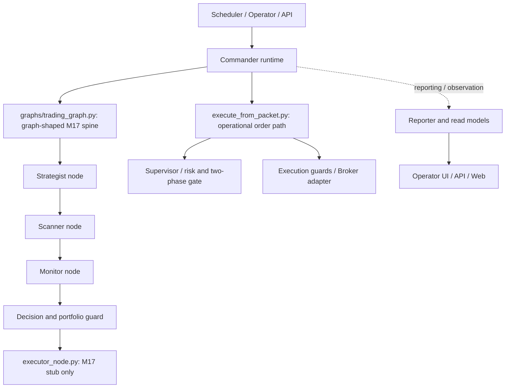

> **PINNED ARCHITECTURE SNAPSHOT — NOT CURRENT RUNTIME VERIFICATION (2026-10-20).** Source `f555165b` and the draft seven-agent diagram below describe their inspected revision, not an implementation guarantee at today’s HEAD. For current navigation use [refactor entry](../README.md), frozen target [TREE_V3](TREE_V3_FROZEN.md), [D00](../../ENGINEERING_DELIVERY_POLICY.md) and [Issue #20](https://github.com/hbombheart1230-dotcom/agentra/issues/20). No architecture migration or execution authority follows from this snapshot.

# Agentra — current integrated seven-agent architecture

Source SHA: f555165b1abcf64b03e9c370844611dabe40c949
State: GPT ARCHITECTURE_DRAFT / ARCH_CONVERGENCE_NOT_APPROVED
Scope: merged T4 + PR #5, no source changes or physical module relocation.

## Runtime and Graph spine

## Verified responsibility anchors
| Agent | Canonical source | Related core | Current concern |
|---|---|---|---|
| Commander | graphs/commander_runtime.py | libs/runtime/commander/ | route and State effects remain mixed |
| Strategist | graphs/nodes/strategist_node.py | libs/runtime/strategist/ | LLM/news/feedback contract |
| Scanner | graphs/nodes/scanner_node.py | libs/runtime/scanner/ | rank/Top-1 authority |
| Monitor | graphs/nodes/monitor_node.py | libs/runtime/monitor/ and libs/runtime/monitor_exit/ | position, entry/exit intents |
| Reporter | graphs/nodes/reporter_node.py; libs/agent/reporter.py | libs/reporting/ | operational Reporter vs Evaluation/Research |
| Supervisor | libs/risk/supervisor.py; libs/supervisor/two_phase.py | libs/supervisor/ | approvals, CAS, UNKNOWN quarantine |
| Executor | graphs/nodes/execute_from_packet.py | libs/execution/ | actual order capability, SAFETY_LOCK |

**Critical finding:** graphs/trading_graph.py explicitly says it avoids a hard LangGraph dependency. Its executor_node.py marks execution_pending only (stub); actual execute_from_packet.py is separately imported by Commander. Do not conflate this graph baseline with a proven LangGraph StateGraph or a broker-enabled graph Executor.

**Evidence limits:** This is an architecture overview assembled from verified imports, module docstrings, and merged SHA. Arrows are conceptual runtime/ownership relationships, not a complete static/dynamic call graph. Injected callbacks, dynamic imports, monkeypatch seams, exact State order, event writes, and external callers need independent audit.

## Consolidated file footprint at merge
- Total tracked files: 3,542
- libs/reporting/: 500; libs/runtime/: 319; graphs/nodes/: 33; apps/operator_ui/: 37
- Root scripts remain and PR #5 retains 141 compatibility wrappers; do not remove based on filename scan alone.
- PR #5 has 9 independent Reporter relocations, while conflicting obsolete copies were excluded before merge.

## Invariants
Keep main, Supervisor/Executor/Broker, Step5C CAS, UNKNOWN quarantine, UEF publication, real LLM prompts, output byte formats, and operational Q10/Q12 paths untouched until separate approval.

Status: ARCH_CONVERGENCE_NOT_APPROVED. Source architecture is subject to Codex consumer/dynamic-boundary audit.
